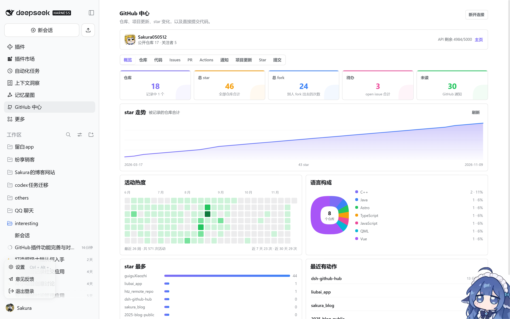
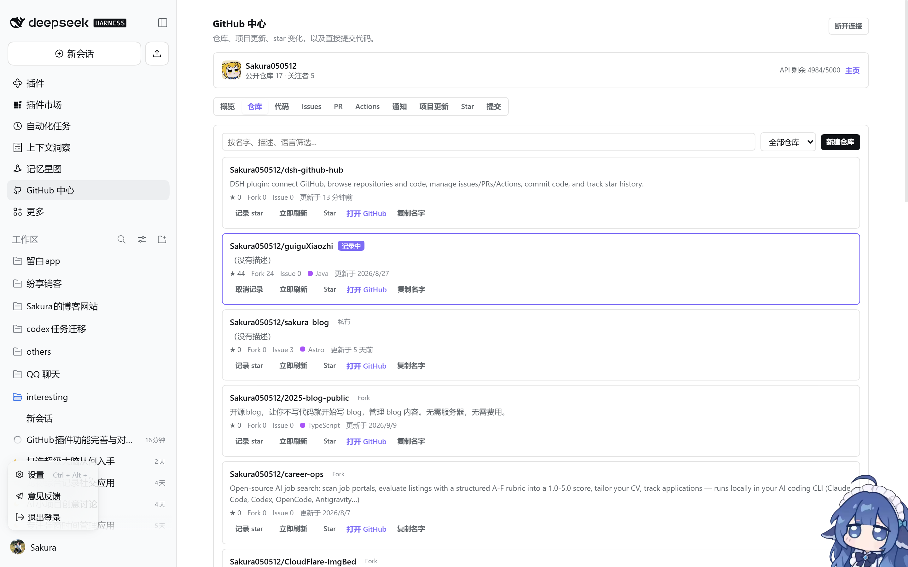
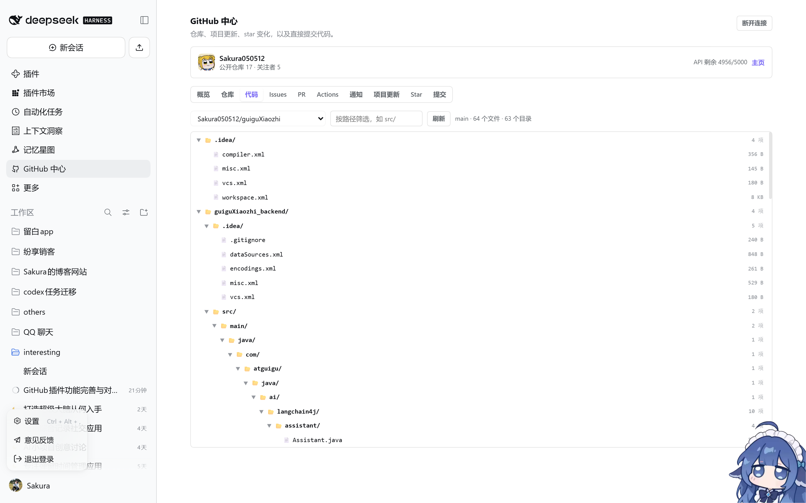
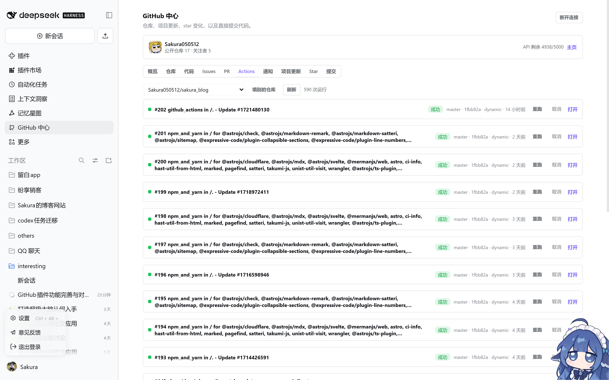
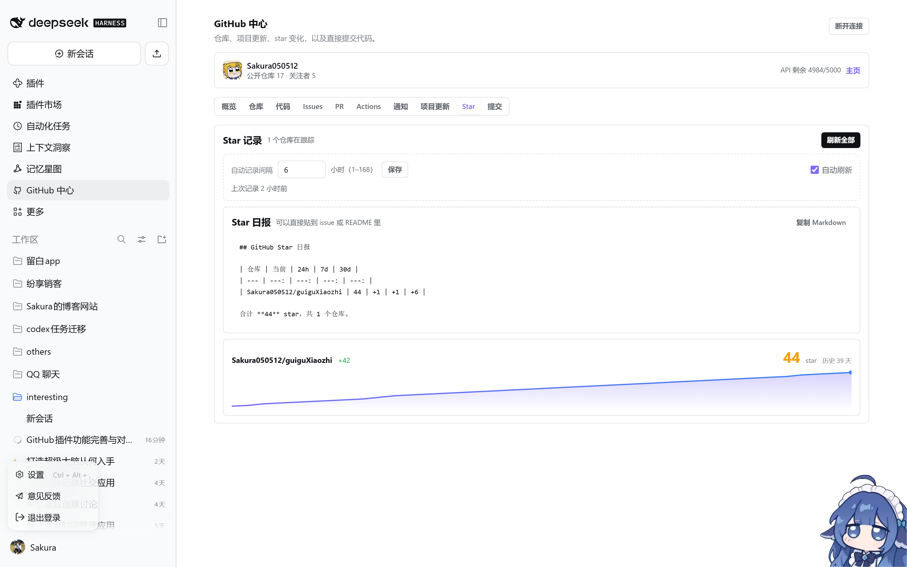

# GitHub 中心（dsh-github-hub）

把 GitHub 接进 DeepSeek Harness：连上你的账号，看仓库、项目更新、star 变化，还能直接把文件推到仓库。

## 装什么

打开 **设置 → GitHub 中心** 或 **左侧栏 → GitHub 中心**，两条路都能连上账号。

### 1. 设备流（推荐，不用创建 Token）

点「用浏览器授权（设备流）」→ 页面给出一个 6 位码 → 打开 `github.com/login/device` 输进去 → 插件轮询到 Token 后自动保存并连上。

设备流用的是 GitHub CLI 的公开 OAuth App（`client_id` = `178c6fc778ccc68e1d6a`），所以你不需要自己注册应用。想用自己的 App，就把 client_id 写进插件配置的 `deviceClientId`。

### 2. 粘贴 Personal Access Token

- classic token：勾 `repo`（私有仓库）+ `read:user`；
- fine-grained token：选好仓库，权限给 `Contents: Read and write`、`Metadata: Read`，要用 Actions 再加 `Actions: Read and write`。

两种方式拿到的 Token 都存进 DSH 的凭据库（`$DSH_HOME/.credentials.yaml` 里的 `GITHUB_TOKEN`），不写插件配置、不回传界面。

## 入口

两处都能进：

- **左侧栏 → GitHub 中心**：整页面板，日常用这个。
- **设置 → GitHub 中心**：同样一页，塞在设置里。

## 十个标签页

| 标签 | 作用 |
| --- | --- |
| 概览 | 一屏看全：仓库/star/fork/待办/未读数、star 走势面积图、「活动热度」提交热力图（月份刻度 + 近 7/30 天及连续天数）、语言构成环形图、star 最多的仓库、最近有动作的仓库 |
| 仓库 | 列出你创建/协作/组织的仓库，带 star、fork、issue、语言、最后更新时间；可搜索、可筛选、可 star、可新建仓库 |
| 代码 | 先把整个仓库的文件树拉下来（`git/trees?recursive=1`），折成可折叠的目录树（目录在前、显示每层条目数，点击展开/收起），按路径筛选后点开任意文本文件看带行号的内容（等宽字体）；超过 1 MB 或二进制只给元信息 |
| Issues | 按仓库列 issue，看正文和评论、发评论、关闭/重开、新建 issue；「填别的仓库」能直接查任意公开仓库（比如 `octocat/Hello-World`） |
| PR | 按仓库列 PR，点进去看 diff（红绿着色）、投审核（通过/要求修改/留言）、合并（merge/squash/rebase） |
| Actions | 列 workflow run（状态、分支、提交、触发方式、时间），点开看 job 和每一步的结论，能重跑和取消 |
| 通知 | 未读通知列表，可单条标记已读 |
| 项目更新 | 你的公开活动（推送、建仓库、star、issue、PR、发布）加上跟踪仓库的最新提交，按时间排序 |
| Star | 每个跟踪仓库一条曲线：每天一个快照，历史用 stargazers 的 `starred_at` 反推；下方「Star 日报」生成一张可直接贴走的 Markdown 表（当前/24h/7d/30d） |
| 提交 | 选仓库 + 分支 + 提交说明，可加任意多个文件（逐个填路径和内容，也能从本机选文件批量填充），一次 commit 全部推上去；同一页还能发 Release（tag + 标题 + 说明 + 预发布） |

## 给 AI 用的工具

除了界面，插件还注册了七个 agent 工具。你可以直接说「看看 sakura_blog 的 CI 为什么挂了」「把某个文件的内容读给我」：

| 工具 | 能做什么 |
| --- | --- |
| `github_repo` | 列仓库、看单个仓库、新建仓库、加/取消 star |
| `github_issue` | 列 issue、看详情、新建、评论、关闭/重开 |
| `github_pr` | 列 PR、看详情与 diff、投审核、合并 |
| `github_push` | 一次提交多个文件（Git Data API，非强推） |
| `github_notifications` | 看未读通知、标记已读 |
| `github_code` | 列文件树、读某个文件的全文、发 Release（不用 clone） |
| `github_actions` | 列 workflow 运行、看 job 与每一步、重跑、取消 |

## Star 是怎么记的

- 点「记录 star」时立刻抓一次当前 star 数，存进 `$DSH_HOME/github-hub.json`。
- 第一次记录时会回溯最后 20 页 stargazers（最多 2000 个 star 的时间点），反推出每天的历史值，
  所以刚接上就能看到一条真实曲线，而不是从今天开始。
- 之后每 10 分钟检查一次是否到点，默认 6 小时刷新一次；可在设置里改间隔或关掉自动刷新。
- 每个仓库最多留 800 个快照、2000 个历史点，不会无限长。

## 提交代码怎么保证安全

用的是 GitHub 的 Git Data API（blob → tree → commit → 移动分支），不是 force push：

1. 读分支当前的 head 提交；
2. 以它为 `base_tree` 建新 tree，只改你指定的那个文件；
3. 建 commit，父提交就是刚才那个 head；
4. 非强制移动分支头。

所以如果读 head 到移分支之间有人推了新提交，GitHub 会直接拒绝，不会把别人的提交冲掉。

## 接口

宿主端注册 `/dsh-github-hub/*`：

| 方法 | 路径 | 说明 |
| --- | --- | --- |
| GET | `/state` | 连接状态、账号、API 额度、跟踪设置、已记录的仓库 |
| GET | `/overview` | 概览看板：合计数据、语言构成、提交热力图（取最近 6 个自有仓库的 `stats/commit_activity`）、star 合计曲线、最近动作 |
| POST | `/token` | 验证并保存 Token（先 `GET /user` 探一次） |
| DELETE | `/token` | 断开连接 |
| GET | `/repos?perPage=&page=&sort=&affiliation=&q=` | 仓库列表 |
| GET | `/repo?full=owner/name` | 单仓库详情 + 最近提交 + 最近发布 + star 曲线 |
| GET | `/feed` | 项目更新流 |
| POST | `/refresh` | `{fulls?}` 抓一次 star 快照 |
| POST | `/track` | `{full, tracked}` 开始/停止记录 |
| POST | `/settings` | `{refreshHours?, autoRefresh?, tracked?}` |
| POST | `/star` | `{full, starred?}` 加/取消 star（不给 starred 就取反） |
| POST | `/create-repo` | `{name, description?, private?, autoInit?, tracked?}` 新建仓库 |
| POST | `/push` | `{full, branch?, message?, files:[{path, content}]}` |
| GET | `/issues?full=&state=&perPage=&page=&labels=&assignee=` | 列 issue（自动剔除 PR） |
| GET | `/issue?full=&number=` | 单个 issue + 评论 |
| POST | `/issue` | `{full, title, body?, labels?, assignees?}` 新建 issue |
| POST | `/issue/comment` | `{full, number, body}` 发评论 |
| POST | `/issue/edit` | `{full, number, state?, title?, body?, labels?}` 改 issue |
| GET | `/labels?full=` | 仓库标签列表 |
| GET | `/pulls?full=&state=&perPage=&page=` | 列 PR |
| GET | `/pull?full=&number=` | 单个 PR + 改动文件（含 patch）+ 评论 |
| POST | `/pull/review` | `{full, number, event, body?}` 投审核 |
| POST | `/pull/merge` | `{full, number, method?, commitTitle?}` 合并 |
| GET | `/notifications` | 未读通知 |
| POST | `/notifications/read` | `{id}` 标记已读 |
| GET | `/search?scope=&q=` | 在账号内搜 issue/PR（scope: all/issues/prs） |
| GET | `/branches?full=` | 分支列表 |
| GET | `/stars?full=` | 已记录的 star 数据 |
| GET | `/actions?full=&perPage=&page=&branch=` | 列 workflow run |
| GET | `/actions/jobs?full=&id=` | 某次运行的 job 与步骤 |
| POST | `/actions/rerun` | `{full, id}` 重跑一次运行 |
| POST | `/actions/cancel` | `{full, id}` 取消一次运行 |
| GET | `/actions/logs` | `full, id, job?` 拉这次运行的 job 日志原文（最多 8 个 job、40 万字符） |
| GET | `/contents?full=&path=&ref=` | 读文件内容（文本直接给 `text`，二进制或 >1 MB 只给元信息） |
| GET | `/tree?full=&ref=` | 递归文件树，只返回 blob，最多 3000 条 |
| POST | `/release` | `{full, tag, name?, body?, prerelease?, draft?}` 发布 Release |
| POST | `/device/start` | 开始设备流，返回 6 位 `userCode` 与授权链接 |
| POST | `/device/poll` | `{deviceCode}` 轮询，拿到 token 后自动存进凭据库 |
| GET | `/report` | Star 日报的 Markdown |

## 限制

- star 回溯最多 20 页（2000 个 star 时间点），超过这个量最老的那段是缺的。
- 代码浏览只读：不能改、不能删、不能下载整个仓库；大文件和二进制只显示元信息。
- 提交一次最多 8 个文件（界面不额外限制，但超大文件受 Git Blob 与请求体 2 MB 约束）。
- 私有仓库需要 token 有对应权限；组织仓库还要你在组织里授权该 token。
- 走代理时 GitHub 的大响应（2MB 的 PR 列表）偶尔会卡几十秒，GET 已加 3 次重试；列表默认只要 10 条就是为了压小包体。
- 通知只有「标记已读」，没有订阅管理。
- Actions 日志一次最多展开 8 个 job、40 万字符，超了会截断；GitHub 把日志重定向到 Azure Blob，现在多数返回纯文本，老运行仍是 zip，两种都支持。
